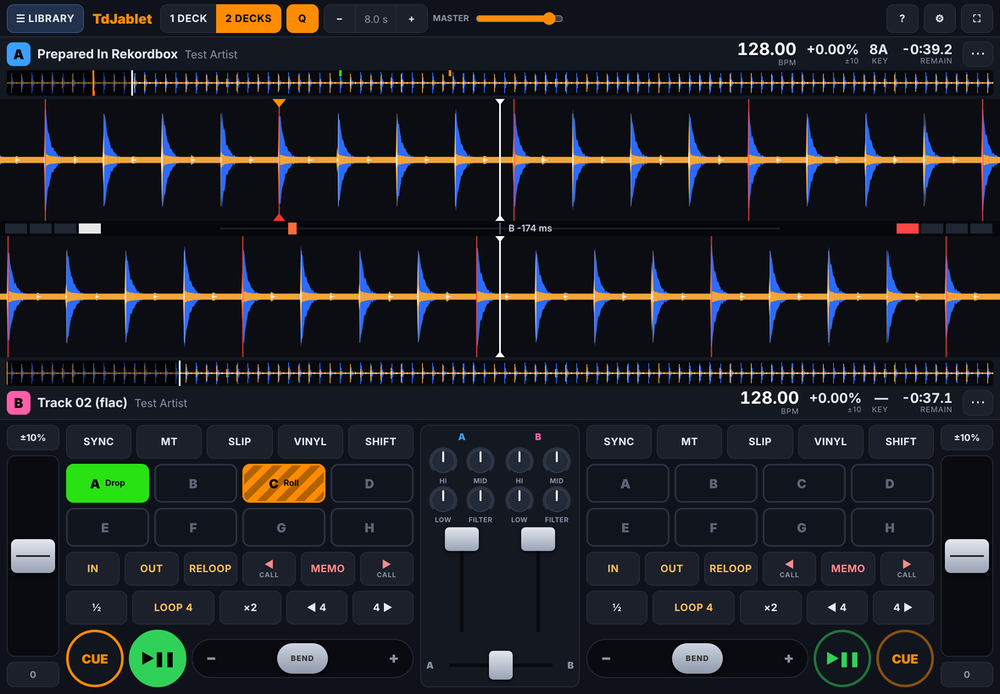

# TdJablet

A CDJ-style DJ player that runs in the browser on a tablet (iPad or Android) and installs like an app. It has two decks with a built-in mixer, or one deck if you plug the tablet into a real mixer. It reads rekordbox-prepared USB sticks and XML exports, and plays practically any audio format.

Instead of a virtual jog wheel it has **the Tape**: a touch control designed for glass rather than copied from hardware.



## The Tape: what replaces the jog wheel

A jog wheel works because you can *feel* it: the edge of the platter, the resistance, how far you turned. On a touchscreen you get none of that. A virtual platter under a fingertip is small, imprecise, and your finger hides what you're doing.

So TdJablet drops the platter. The Tape is each deck's zoomed waveform, and **you drag the music itself**. Deck A's tape sits directly above deck B's, so you can *see* whether the beats line up.

| Situation | Drag the tape to… |
|---|---|
| **CDJ mode, playing** | **Phase push.** Drag the waveform until its beat lines meet the other deck's. The deck glides there with a short, smooth pitch bend. You decide *where the beat goes*, not *how hard to spin*. Small pushes bend gently (≤ ~12 %); big ones bend harder so the deck still arrives in about a second. |
| **CDJ mode, paused** | **Search** with audible scrubbing, then press CUE to set the cue point. |
| **VINYL on** | **Scratch.** Touching is your hand on the record: hold still to stop it, drag to scratch, let go to release. With SLIP on, the track carries on underneath. |

Other touch-native ideas:

- **Fine control by sliding away.** While dragging the tape, slide your finger up or down *off* the tape and the same movement moves the music less (½, ¼, …), like fine scrubbing on a phone. The tempo fader and knobs do the same sideways. You never need to zoom in for precision.
- **Bend lever.** A spring-loaded lever next to PLAY. Hold it left or right to run slower or faster *for as long as you hold it*. A jog wheel can't do that without continuous spinning. The response is quadratic, so small deflections give the 0.1–1 % nudges beatmatching needs.
- **Phase meter** between the tapes: each deck's beat in the bar, plus how many milliseconds deck B is ahead or behind deck A (green means in phase). The Tape shows where you *asked* the beat to go; the meter shows where it actually is.
- **Pinch** the tapes to zoom (both zoom together, so beats stay comparable).
- All faders and knobs drag *relatively*: touching a control never makes it jump to your finger.

The rest works like a CDJ:

- **CUE / PLAY:** CUE while paused sets the cue point, holding CUE previews, CUE while playing returns and stops.
- **Hot cues A–H:** tap an empty pad to store one, SHIFT + pad deletes.
- **Memory cues:** ◀ / ▶ CALL steps through them, MEMO stores one.
- **Loops:** auto beat loops with ½ / ×2, IN/OUT, RELOOP, and beat jump.
- **Tempo and timing:** quantize, beat SYNC, master tempo (key lock), slip, reverse, tempo ranges ±6/10/16 % and WIDE.
- **Safety:** needle search on the overview waveform, load lock.

## Putting it on your tablet

The app is a static web page, so GitHub Pages can host it for free. HTTPS is required: browsers only allow the audio engine (AudioWorklet) on `https://` or `localhost`.

1. Merge this branch into `main`.
2. In the repository on GitHub, go to **Settings → Pages → Build and deployment → Source** and choose **GitHub Actions**.
3. The *Deploy to GitHub Pages* workflow runs on every push to `main`. It runs the tests, bundles ffmpeg.wasm and publishes the site at `https://<your-user>.github.io/TdJablet/`.
4. Open that address on the tablet and add it to the home screen:
   - **iPad:** Share → Add to Home Screen.
   - **Android/Chrome:** ⋮ → Install app.

   It then opens full screen, keeps the screen awake while you play, and works **offline**. Audio you import is copied into the browser's storage on the tablet; nothing is uploaded anywhere.

### Running it on your computer

```sh
npm run serve          # or: python3 -m http.server 8080
# open http://localhost:8080
```

On a computer you can drop files onto the window. To test on the tablet use the GitHub Pages URL. Plain `http://<your-pc>:8080` from the tablet won't work, because it isn't a secure context.

## Music and rekordbox

**Formats.** The browser decodes MP3, AAC/M4A, FLAC, WAV, Ogg Vorbis and Opus, and on Safari also AIFF and ALAC. TdJablet adds:
- its own WAV/AIFF/AIFF-C reader, so AIFF works on Android too;
- [ffmpeg.wasm](https://github.com/ffmpegwasm/ffmpeg.wasm) for everything else: ALAC on Chrome/Android, WMA, APE, WavPack, and so on.

The 31 MB ffmpeg file is only downloaded the first time it's needed, then cached for offline use. Run `npm run fetch-ffmpeg` to bundle it locally.

**Library → ＋ Folder / USB** with a rekordbox USB stick (pick the folder that contains `PIONEER`) imports:
- **From `export.pdb`:** titles, artists, BPM, key, colours, ratings and playlists.
- **From the ANLZ analysis files:** beat grids (including tempo changes), and hot cues and memory cues (with names, colours and loops).

The audio is matched by its path on the stick.

**Library → ＋ rekordbox XML** (in rekordbox: *File → Export Collection in xml format*) brings in the same information from a file. Then add the music files or folder: they're linked to the rekordbox tracks automatically by file name and size. This is the easiest route on an iPad, where Safari can't open whole folders.

Tracks without rekordbox data get a BPM and a beat grid from TdJablet's own detector. You can fix a grid from the deck's **⋯** menu: *Beat 1 is here*, nudge the grid ±5 ms, ×2 / ÷2, or type a BPM.

Things to know:
- Nothing is ever written back to rekordbox or the USB stick. Cues you add on the tablet live on the tablet, and re-importing a rekordbox export replaces a track's cues with rekordbox's.
- Not imported: phrase analysis, rekordbox's own waveforms (TdJablet draws its own three-band waveform) and history.
- Different MP3 decoders sometimes disagree by a few milliseconds about where a track starts. If rekordbox grids look consistently early or late on your files, set **Settings → rekordbox grid & cue offset**.

## Sound output

**Settings → Audio output:**

- **Stereo master:** speakers, headphone jack, or any USB interface.
- **Split cue:** mono master left, mono headphone cue right. Use with a Y-splitter cable.
- **Master 1/2 + headphones 3/4:** for a 4-output USB audio interface.
- **External mixer, A → 1/2, B → 3/4:** use the tablet as *two CDJs* feeding a real DJ mixer. The built-in mixer disappears.

## How the code is organised

Plain JavaScript modules with no build step and no dependencies, written as small classes. If you know C++ and OOP it should read familiarly: no frameworks and no magic.

| | |
|---|---|
| `js/audio/dsp/DeckCore.js` | **The heart.** Everything one deck does to make sound, sample by sample. It plays a track from memory with cubic interpolation, and covers CDJ/vinyl start and stop, the scratch follower (a critically damped spring that turns jittery touch events into smooth motion), phase push, loops, slip and jump cross-fades. No Web Audio dependencies, so it's unit-testable. |
| `js/audio/dsp/TimeStretch.js` | Master tempo (key lock): a WSOLA time-stretcher, simplified because the whole track is in memory. |
| `js/audio/engine-processor.js` | The AudioWorklet that runs both decks on the audio thread, plus sample-accurate beat sync. |
| `js/audio/AudioEngine.js` | Main-thread side: AudioContext, mixer (EQ, filter, faders, cue), output routing, latency-compensated playhead positions. |
| `js/Deck.js` | CDJ behaviour: what CUE, hot cues, loops, memory cues, sync and tempo ranges *do*. |
| `js/ui/Tape.js` | The Tape: gestures and waveform drawing. |
| `js/ui/*` | The rest of the interface (deck panels, controls, mixer, library browser, settings). |
| `js/analysis/` | Three-band waveform and BPM/beat-phase detection, in a Web Worker. |
| `js/decode/` | Decoding chain, WAV/AIFF parser, ffmpeg.wasm wrapper, tag reader (ID3, FLAC, MP4, RIFF). |
| `js/rekordbox/` | Readers for `export.pdb`, ANLZ files and rekordbox XML. |
| `js/library/` | Library model and IndexedDB storage. |

## Tests

```sh
npm test               # unit tests: engine DSP, BPM detection, decoders, tags, rekordbox readers
npm run e2e            # drives the real app in headless Chromium (needs ffmpeg + Playwright)
node tests/e2e/run.mjs --shots   # same, and saves screenshots to test-results/
```

The rekordbox tests use real exports from the [rekordcrate](https://github.com/Holzhaus/rekordcrate) project, including a 3,886-track library. They are downloaded into `tests/fixtures/` on the first run and not committed.

What the end-to-end test checks:
- **Import and analysis:** all 8 test formats decode and analyse at the right BPM, the XML and USB imports both work, and the deck loads at the first memory cue.
- **Tape gestures:** a 20 px Tape drag moves the deck by exactly the dragged amount, and a vinyl scratch follows the finger.
- **Deck controls:** sync locks within a millisecond, and hot cues, loops and CUE work.
- **Layout:** fits 1024×768, 1180×820 and 1280×800 without overflow.

## Honest limitations

- Developed and tested in desktop and headless Chromium. Safari/iPad and real Android hardware still need a try-out on your own tablet, especially for audio latency, which depends on the device.
- iPadOS Safari can't pick whole folders, so on iPad use the rekordbox XML route, or select the files.
- Key lock uses WSOLA: clean for normal tempo changes, but not as good as commercial stretchers at extreme settings.
- BPM detection assumes a steady tempo. rekordbox grids handle tempo changes.
- No MIDI controller support yet. Web MIDI would work on Android/Chrome, but not on iPad.

## Credits

- rekordbox file formats were reverse-engineered by [Deep Symmetry](https://djl-analysis.deepsymmetry.org/) and the [rekordcrate](https://github.com/Holzhaus/rekordcrate) project. rekordbox and CDJ are trademarks of AlphaTheta Corporation; TdJablet is not affiliated with them.
- [ffmpeg.wasm](https://github.com/ffmpegwasm/ffmpeg.wasm) is bundled at deploy time under its own licence (FFmpeg is LGPL/GPL).
